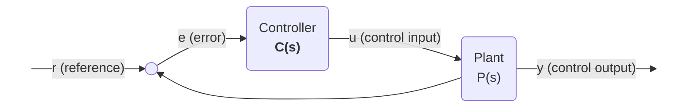
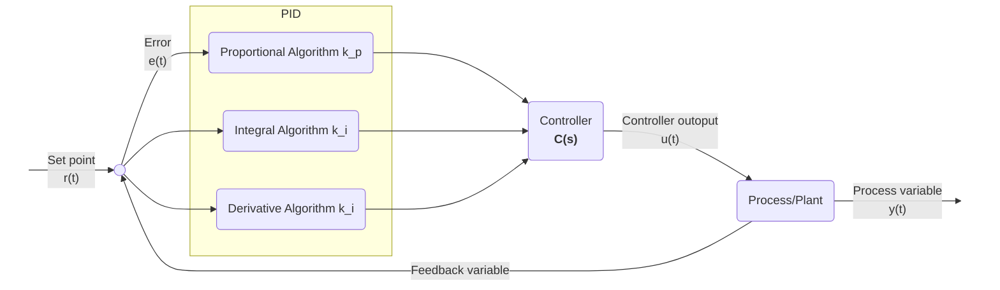

# Lab 4
Closed loop control

[Link to lab](https://ucr-ee106.readthedocs.io/en/latest/lab4.html)

---

### Notes



**More in detail:**



The **Plant (Ps)** is what we want to control
- **Control input $`u`$:** velocity command we send to the robot
- **Control output $`y`$:** current state (2D pose)
- **Reference $`r`$:** desired state we want to robot to reach

The controller takes the tracking error $`e = r-y`$, and computes the control input $`u`$ according to the following **PID** equation, being $`e(t)`$ the error with respect to time:

```math
u(t)=\underbrace{k_pe(t)}_{\text{\underline{P}roportional}}+\underbrace{k_i\int e(t)dt}_{\text{\underline{I}ntegral}}+\underbrace{k_d \frac{de(t)}{dt}}_{\text{\underline{D}erivative}}
```

$`k_p, k_i, k_d`$ are the coefficients we need to tune.

**For this lab we will simplify the above equation to the following one (PD):**
```math
u(t)=k_pe(t)+k_d(e(t)-e(t-\Delta t))
```


bot can only move from -pi to pi